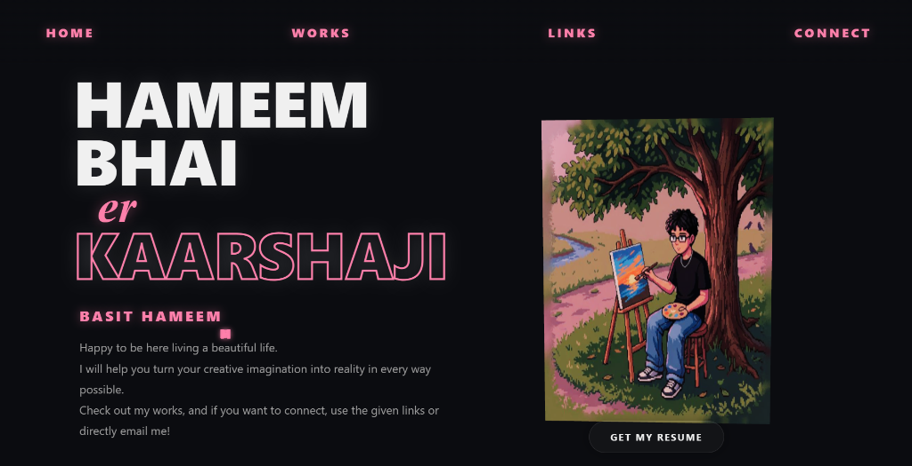
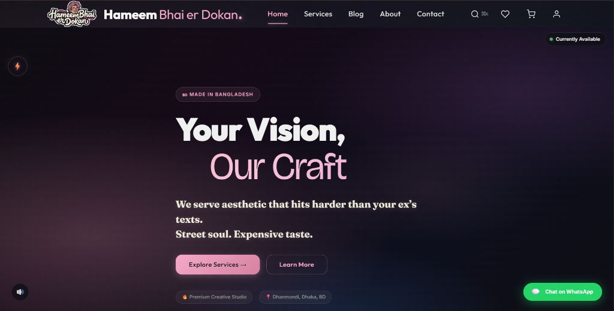

<div align="center">


<br/>


<br/><br/>


<br/>

[](https://hameembhai.me)
&nbsp;·&nbsp;
[](https://hameembhaierdokan.studio)
&nbsp;·&nbsp;
[](https://github.com/Hameem-Bhai?tab=repositories)
&nbsp;·&nbsp;


</div>

<br/>

---

<br/>

```yaml
name:       Hameem Basit
alias:      Hameem Bhai
university: AIUB — Computer Network & Cyber Security
status:     always building something
interests:  [ web dev, cybersecurity, ai experiments, creative tech ]
motto:      "learn it. build it. make it better."
```

<br/>

Hey, I'm **Hameem Basit** — a CS undergrad who builds things on the internet and calls it fun.
I enjoy making websites, poking at AI tools, learning how systems tick under the hood, and turning half-baked ideas into actual projects. Still learning, still shipping, always improving.

<br/>

---

<br/>

<div align="center"><sub>✦ &nbsp; featured work &nbsp; ✦</sub></div>

<br/>

<table>
<tr>
<td width="50%" valign="top">

**🌌 Personal Portfolio**

My own space on the internet. Work, ideas, creative identity.
<br/><sub>[→ hameembhai.me](https://hameembhai.me)</sub>

<a href="https://hameembhai.me"></a>

</td>
<td width="50%" valign="top">

**🛍️ Hameem Bhai er Dokan**

Creative digital products and web-dev services.
<br/><sub>[→ hameembhaierdokan.studio](https://hameembhaierdokan.studio)</sub>

<a href="https://hameembhaierdokan.studio"></a>

</td>
</tr>
<tr>
<td width="50%" valign="top">
<br/>

**🚗 DriverDen**

University project — driver-hiring platform with customer, driver, and admin flows. Built it from scratch, learned a ton.
<br/><sub>[→ view on github](https://github.com/Hameem-Bhai?tab=repositories)</sub>

</td>
<td width="50%" valign="top">
<br/>

**🧪 Programming & Coursework**

C++ algorithms · Java GUI · web apps. Every project is a chance to get a little better at the fundamentals.
<br/><sub>[→ browse all repos](https://github.com/Hameem-Bhai?tab=repositories)</sub>

</td>
</tr>
</table>

<br/>

---

<br/>

<div align="center">

<sub>✦ &nbsp; toolkit &nbsp; ✦</sub>

<br/><br/>


<br/><br/>

<sub>languages &nbsp;·&nbsp; c++ · java · python · javascript</sub><br/>
<sub>web &nbsp;·&nbsp; html · css · javascript · php</sub><br/>
<sub>data &nbsp;·&nbsp; mysql · sql</sub><br/>
<sub>tools &nbsp;·&nbsp; git · github · vscode · xampp</sub><br/>
<sub>degree focus &nbsp;·&nbsp; computer networks · cybersecurity</sub>

</div>

<br/>

---

<br/>

<div align="center"><sub>✦ &nbsp; currently focused on &nbsp; ✦</sub></div>

<br/>

```
🔩  stronger fundamentals   →  understand the logic, not just make it run
🌐  useful projects         →  coursework ideas → working applications
🔐  cybersecurity           →  deepen networking and security knowledge
🤖  creative tech           →  ai-assisted workflows, expressive web design
📦  keep shipping           →  document, improve, repeat
```

<br/>

---

<br/>

<div align="center">

<sub>✦ &nbsp; github activity &nbsp; ✦</sub>

<br/><br/>


<br/>


<br/>


<br/>

<sub>stats cards are from external services and may occasionally be unavailable &nbsp;·&nbsp; language % ≠ proficiency</sub>

</div>

<br/>

---

<br/>

<div align="center">


<br/>

*the goal isn't to look like a developer. it's to become a better builder.*

<br/>

<sub>hameem bhai &nbsp;·&nbsp; made with curiosity and a little bit of mental unstableness 🩷</sub>

</div>
