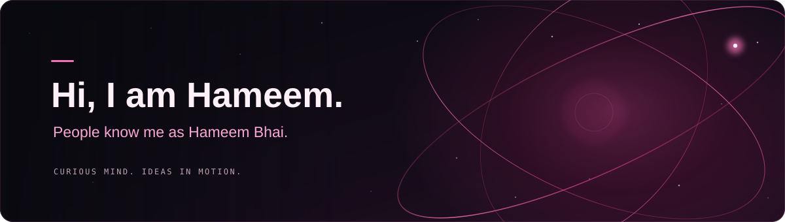

<!-- ═══════════════════ ENTER ORBIT ═══════════════════ -->

  

 

  

<code>The name is familiar. The next idea won't be.</code>

 

<!-- ═══════════════════ THE SOUNDTRACK ═══════════════════ -->

<h3>🎧 Hameem Bhai — After Hours</h3>

  Behind the next idea, there's probably a track on repeat.

 

---

<!-- ═══════════════════ THE HUMAN ═══════════════════ -->

## 🪩 Behind the Username

Hey, I'm Hameem — people know me as Hameem Bhai.

I'm the kind of person who sees something cool and starts wondering,
“Could I make something like that — but my way?”

Sometimes that means writing code. Sometimes it means experimenting
with AI. Either way, I want to turn what's in my head into something
you can actually try.

- 🧠 Exploring AI prompting — better questions, clearer direction, better results.
- 🛠️ Experimenting with AI to build things and bring ideas to life.
- 🎮 Interested in games, interactive experiences, and websites with personality.
- 🌱 Expanding my skills instead of putting myself in one little box.
- 🤝 Open to interesting collaborations and slightly ridiculous project ideas.
- 🐈 Cat included. Technical contributions uncertain.

 

 

---

<!-- ═══════════════════ CURRENT ORBIT ═══════════════════ -->

## 🧠 Currently in My Orbit

<table>
<tr>
<td width="50%" valign="top">

### ✦ AI & Prompting

Learning how to give AI better direction.

Clearer context, smarter questions, more useful results —
and knowing when the answer needs another pass.

</td>
<td width="50%" valign="top">

### ✦ Building with AI

Taking an idea beyond the conversation.

Using AI to help explore possibilities, put together a first version,
and keep improving what comes out.

</td>
</tr>
<tr>
<td width="50%" valign="top">

### ✦ Interactive Experiences

Making things that invite you to explore.

Websites with personality, playful interactions,
and details that make you stop scrolling for a second.

</td>
<td width="50%" valign="top">

### ✦ Expanding the Toolkit

More skills. More ways to make an idea happen.

Picking up what helps me create —
without making one language or tool my entire identity.

</td>
</tr>
</table>

 

<!-- ═══════════════════ TOOLKIT ═══════════════════ -->

## ⚡ Tools, Code & Curiosity

  

  

Things I've built with. Things I'm exploring. Never the whole list.

 

---

<!-- ═══════════════════ THE BUILDS ═══════════════════ -->

## 🛠️ From My Side of the Internet

<table>
<tr>
<td width="50%" valign="top">

### 🍽️ Dhaba Ordering System

A Java desktop ordering project with menu browsing and an order cart.

A little restaurant logic, a little GUI work,
and a lot of figuring things out.

 

  

<a href="https://github.com/Hameem-Bhai/Dhaba_Ordering_System">Take a look ↗</a>

</td>
<td width="50%" valign="top">

### 🌌 Interactive Portfolio

My own little digital playground.

An interactive cursor, a 3D model,
and a place to show what I've been making.

 

  

<a href="https://github.com/Hameem-Bhai/my-portfolio">Step inside ↗</a>

</td>
</tr>
<tr>
<td width="50%" valign="top">

### 🛍️ E-commerce Website

A JavaScript storefront project.

Exploring the building blocks of a shopping experience on the web.

 

  

<a href="https://github.com/Hameem-Bhai/Hameem_e-commerce_website">Browse the code ↗</a>

</td>
<td width="50%" valign="top">

### 🧪 The Next “What If?”

An AI experiment? A game idea?
Something oddly specific that I can't stop thinking about?

That's usually where the next project starts.

 

  

<a href="https://github.com/Hameem-Bhai?tab=repositories">Explore all my repos ↗</a>

</td>
</tr>
</table>

 

<!-- ═══════════════════ THE MINDSET ═══════════════════ -->

## 💭 The Way I See It

> I'm not learning all this just to know more.
> I'm learning so that when an idea hits, I can actually make it real.

 

<code>💡 Imagine it</code>
&nbsp; → &nbsp;
<code>🛠️ Build a version</code>
&nbsp; → &nbsp;
<code>🧪 Question it</code>
&nbsp; → &nbsp;
<code>✨ Make it better</code>

 

---

<!-- ═══════════════════ CONTACT ═══════════════════ -->

## 💌 Got Something Cool in Mind?

An AI experiment, a game idea, a website,
or something neither of us has a proper name for yet?

That sounds like a good conversation.

 

  

<code>basithameem@gmail.com</code>

  

The button opens Gmail. Using another email app? Copy the address above.

 

---

<!-- ═══════════════════ SIGNING OFF ═══════════════════ -->

 

Hameem Bhai — turning “imagine if” into “try this.”

More skills. Bigger ideas. Better things to put my name on.

  

🐈

